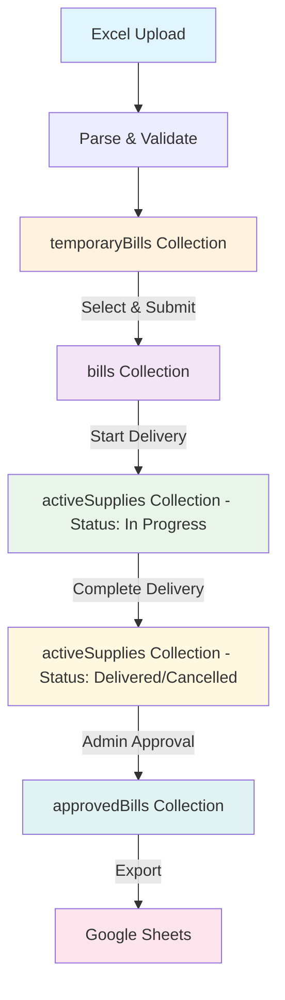
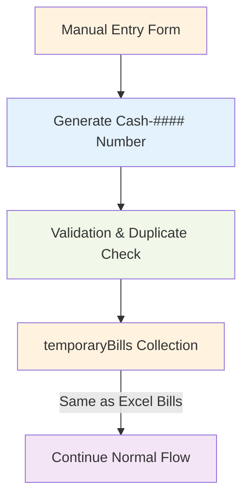
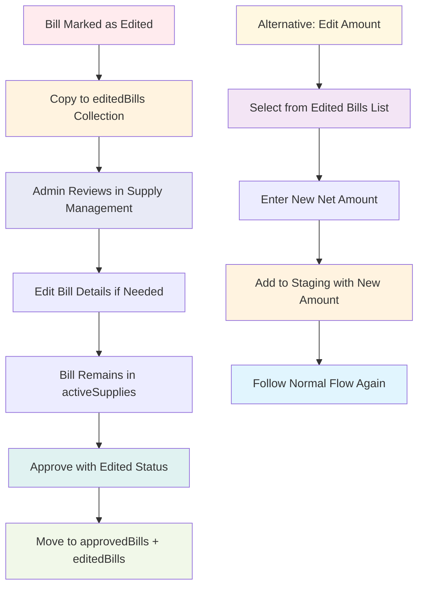

# BeautyBasket by DLS - Complete Data Flow Documentation for Supabase Migration

## Table of Contents
1. [System Overview](#system-overview)
2. [Current Architecture](#current-architecture)
3. [Data Models](#data-models)
4. [Process Flows](#process-flows)
5. [Firebase to Supabase Migration Map](#firebase-to-supabase-migration-map)
6. [Critical Implementation Notes](#critical-implementation-notes)

## System Overview

BeautyBasket is a supply chain management system for DLS handling three main processes:
- **SUPPLY**: Managing bill dispatch and delivery
- **UGRAI**: Managing bill collections and payments
- **PURCHASE**: Managing purchase entries and accounting

The system currently uses Firebase/Firestore with real-time listeners and is designed for multi-user environments with user-specific data isolation.

## Current Architecture

### Firebase Structure
```
artifacts/
  └── ${appId}/
      └── users/
          └── ${userId}/
              ├── temporaryBills/        # Staged bills before dispatch
              ├── bills/                 # Bills ready for dispatch
              ├── activeSupplies/        # Bills being delivered
              ├── approvedBills/         # Completed deliveries
              ├── retailers/             # Master retailer data
              ├── editedBills/           # Bills that were modified
              ├── purchaseRetailers/     # Purchase-specific retailers
              └── purchaseEntries/       # Purchase transactions
```

### Authentication & State Management
- Uses Firebase Anonymous Authentication with custom tokens
- AppState class manages all data with real-time synchronization
- Mock mode available for development/testing
- Theme persistence in localStorage

## Data Models

### 1. Retailers Collection
```javascript
{
  id: string,               // Auto-generated document ID
  name: string,             // "Gupta Store"
  sector: string            // "Retail", "Wholesale", "Electronics", "Cosmetics"
}
```

### 2. Temporary Bills Collection (Staging Area)
```javascript
{
  id: string,               // Auto-generated document ID
  uniqueId: string,         // "${billNumber}-${billDate}"
  brand: string,            // "Loreal", "Nivea", "N/A"
  billNumber: string,       // "L-12345" or "Cash-1234"
  billDate: string,         // "2023-10-02" (ISO date format)
  retailerName: string,     // From retailers collection
  sector: string,           // From retailers collection or "N/A"
  netAmount: number,        // 1250.50
  status: string            // "Pending"
}
```

### 3. Bills Collection (Ready for Dispatch)
```javascript
{
  id: string,               // Auto-generated document ID
  uniqueId: string,         // "${billNumber}-${billDate}"
  brand: string,            // "Loreal", "Nivea", "N/A"
  billNumber: string,       // "L-12345"
  billDate: string,         // "2023-10-02"
  retailerName: string,
  sector: string,
  netAmount: number,
  status: string            // "Pending"
}
```

### 4. Active Supplies Collection (In Progress Deliveries)
```javascript
{
  id: string,               // Auto-generated document ID
  uniqueId: string,
  brand: string,
  billNumber: string,
  billDate: string,
  retailerName: string,
  sector: string,
  netAmount: number,
  supplyThrough: string,    // "Self", "Third Party"
  status: string,           // "In Progress", "For Approval", "Edited"
  
  // Delivery completion fields (optional)
  deliveryMethod?: string,  // "Cash", "UPI", "Cheque", "Credit", "NEFT"
  receiptNumber?: string,   // For Cash/UPI/Cheque
  receivedAmount?: number,  // Actual received amount
  chequeDate?: string,      // For Cheque payments
  photoUploaded?: boolean,  // For Cash/UPI/Cheque
  photoUrl?: string,        // Photo storage URL
  completedAt?: string,     // ISO timestamp
  lastUpdated?: string      // ISO timestamp
}
```

### 5. Approved Bills Collection (Completed Deliveries)
```javascript
{
  id: string,               // Auto-generated document ID
  uniqueId: string,
  brand: string,
  billNumber: string,
  billDate: string,
  retailerName: string,
  sector: string,
  netAmount: number,
  supplyThrough: string,
  deliveryMethod: string,   // "Cash", "UPI", "Cheque", "Credit", "NEFT"
  receiptNumber?: string,
  receivedAmount: number,
  chequeDate?: string,
  photoUploaded?: boolean,
  photoUrl?: string,
  status: string,           // "Delivered"
  completedAt: string,      // ISO timestamp
  approvedAt?: string       // ISO timestamp (when approved by admin)
}
```

### 6. Edited Bills Collection (Modified Bills History)
```javascript
{
  id: string,               // Auto-generated document ID
  // All fields from Active Supplies
  // Plus additional audit fields
  originalData?: object,    // Original bill data before edit
  editReason?: string,      // Reason for modification
  editedAt: string,         // ISO timestamp
  editedBy?: string         // User ID who edited
}
```

### 7. UGRAI Data Collections

#### UGRAI Base Data (ugraiData in AppState)
```javascript
{
  id: string,               // "UG-${billNumber}"
  billNumber: string,       // Original bill number
  billDate: string,         // ISO date format
  retailerName: string,
  sector: string,
  netAmount: number,
  status: string            // "Pending", "Assigned", "In Progress", "Completed"
}
```

#### UGRAI Entries (ugraiEntries in AppState)
```javascript
{
  id: string,               // "UG-${Date.now()}-${random}"
  billNumber: string,
  billDate: string,
  retailerName: string,
  sector: string,
  netAmount: number,
  date: string,             // Entry creation date
  status: string,           // "Pending", "Assigned", "In Progress", "Completed"
  billId?: string,          // Reference to original bill
  assignedTo?: string       // Person assigned for collection
}
```

#### Completed UGRAI (completedUgrai in AppState)
```javascript
{
  id: string,
  billNumber: string,
  billDate: string,
  retailerName: string,
  sector: string,
  netAmount: number,
  
  // Payment completion fields
  paymentMethod: string,    // "Cash", "UPI", "Cheque", "NEFT"
  receiptNumber?: string,   // For Cash/UPI/Cheque
  receivedAmount: number,   // Actual collected amount
  chequeDate?: string,      // For Cheque payments
  photoUploaded?: boolean,  // For Cash/UPI/Cheque
  photoUrl?: string,        // Photo storage URL
  
  // Audit fields
  completedAt: string,      // ISO timestamp
  lastUpdated?: string,     // ISO timestamp
  status: string            // "Completed", "Approved"
}
```

#### UGRAI Support Data (In AppState memory)
```javascript
// Persons list for assignment
persons: string[]           // ["Mohan", "Suresh", "Rahul"]

// Sector assignments
ugraiAssignments: {
  [sector: string]: string  // {"Retail": "Mohan", "Wholesale": "Suresh"}
}

// Approved UGRAI (sent to Google Sheets)
approvedUgrai: ApprovedUgraiRecord[]
```

### 8. Purchase Collections

#### Purchase Retailers
```javascript
{
  id: string,               // Auto-generated document ID
  name: string,             // "ABC Suppliers"
  dueDays: number          // 30, 45, 60 (payment terms)
}
```

#### Purchase Entries
```javascript
{
  id: string,               // Auto-generated document ID
  uniqueId: string,         // "PUR-${timestamp}-${random}"
  billNumber: string,       // "INV-2023-001"
  billDate: string,         // ISO date format
  retailerName: string,     // From purchase retailers
  preTaxAmount: number,     // 1000.00
  tax: number,              // 180.00 (18% GST)
  deduction: number,        // 50.00 (TDS/other deductions)
  netAmount: number,        // 1130.00 (preTax + tax - deduction)
  status: string,           // "Received", "Pending for Accounting", "Completed"
  note?: string,            // Optional notes
  createdAt: string,        // ISO timestamp
  
  // Accounting fields (when processed)
  accountedAt?: string,     // ISO timestamp
  accountedBy?: string,     // User ID
  paymentDueDate?: string,  // Calculated based on dueDays
  paymentStatus?: string    // "Pending", "Paid", "Overdue"
}
```

## Process Flows

### 1. SUPPLY Process Flow

#### Stage 1: Base File Management
```
1. Upload retailer Excel file (retailer name, sector)
2. System parses and stores in retailers collection
3. Retailers displayed in filterable table
4. Download functionality for backup
```

#### Stage 2: Upload Supply Data
```
1. Manual entry OR Excel upload of bills
2. Bills validation (brand detection, retailer matching)
3. Storage in temporaryBills collection (staging)
4. Bulk selection and review interface
```

#### Stage 3: Bills to Dispatch
```
1. Move selected bills from temporaryBills → bills collection
2. Display all bills ready for dispatch
3. Bulk selection for dispatch initiation
4. Supply method selection (Self/Third Party)
```

#### Stage 4: Supplies in Progress
```
1. Bills moved from bills → activeSupplies collection
2. Real-time tracking of deliveries
3. Completion forms with delivery details
4. Photo upload for Cash/UPI/Cheque payments
5. Status updates (In Progress → For Approval → Edited)
```

#### Stage 5: Supply Management
```
1. Review completed supplies awaiting approval
2. Edit functionality for corrections
3. Bulk approval and Google Sheets export
4. Historical reporting and filtering
```

### 2. UGRAI Process Flow

#### Stage 1: UGRAI Base File
```
Option A - Upload UGRAI Data:
1. Excel upload with bill details
2. Parse and store in ugraiData array
3. Display in filterable table

Option B - Create from Credit Supplies:
1. Query approved bills with deliveryMethod = "Credit"
2. Select bills for UGRAI creation
3. Generate UGRAI entries in ugraiEntries array
```

#### Stage 2: UGRAI Issue (Assignment)
```
1. Display available persons and sectors
2. Add/remove persons from assignment pool
3. Assign sectors to specific persons
4. Bulk assignment operations
5. Generate assignment report
```

#### Stage 3: UGRAI In Progress
```
1. Display bills assigned to persons
2. Filter by person, sector, bill details
3. Collection completion forms
4. Payment method capture (Cash/UPI/Cheque/NEFT)
5. Photo upload requirements
6. Move to completedUgrai array
```

#### Stage 4: UGRAI Management
```
1. Review completed collections awaiting approval
2. Edit collection details if needed
3. Payment method summaries and analytics
4. Bulk approval to Google Sheets
5. Performance reporting by person/sector
```

### 3. PURCHASE Process Flow

#### Stage 1: Purchase Base File
```
1. Upload purchase retailer data (name, due days)
2. Store in purchaseRetailers collection
3. Display with filtering capabilities
```

#### Stage 2: Purchase Entry
```
1. Manual entry of purchase bills
2. Retailer selection from master data
3. Financial calculations (pre-tax + tax - deductions)
4. Storage in purchaseEntries collection
5. Status tracking (Received → Accounting → Completed)
```

#### Stage 3: Accounting (Pending for Accounting)
```
1. Display entries requiring accounting review
2. Payment due date calculations
3. Bulk processing capabilities
4. Status updates and approval workflow
```

#### Stage 4: Purchase Management
```
1. Comprehensive view of all purchase entries
2. Status-based filtering and reporting
3. Due date tracking and alerts
4. Financial summaries and analytics
```

#### Stage 5: Purchased (Completed)
```
1. Historical view of completed purchases
2. Payment status tracking
3. Vendor performance analytics
4. Export capabilities for accounting systems
```

## Bill Lifecycle Documentation

### Overview
Bills in the BeautyBasket system follow multiple lifecycle paths depending on their origin, processing method, and completion status. This section documents all possible bill states and transitions.

### Bill Status States

```
Available Status Values:
- "Pending"     (Initial state in temporary staging)
- "In Progress" (Being delivered)
- "Delivered"   (Successfully completed delivery)
- "Cancelled"   (Delivery cancelled)
- "Edited"      (Modified after completion, needs re-approval)
- "For Approval" (Awaiting management approval)
- "Approved"    (Final approved state, sent to Google Sheets)
```

### Bill Origin Types

1. **Excel Upload Bills** - Bulk imported from Excel files (L-prefix for Loreal, N-prefix for Nivea)
2. **Manual Cash Bills** - Hand-entered with Cash-#### format
3. **Edited Bills** - Previously completed bills that were modified

### Lifecycle Path 1: Normal Excel Upload Bills



#### Detailed Steps:

**Stage 1: Excel Upload Processing**
```
Input: Excel file with columns [Bill Number, Bill Date, Retailer Name, Net Amount]
Processing:
1. Parse Excel rows
2. Detect brand from bill number prefix (L=Loreal, N=Nivea, Other=N/A)
3. Match retailer names with retailers collection
4. Generate uniqueId = "${billNumber}-${billDate}"
5. Set status = "Pending"
6. Store in temporaryBills collection

Data Structure:
{
  id: "auto-generated",
  uniqueId: "L-12345-2023-10-02",
  brand: "Loreal",
  billNumber: "L-12345",
  billDate: "2023-10-02",
  retailerName: "Gupta Store",
  sector: "Retail",
  netAmount: 1250.50,
  status: "Pending"
}
```

**Stage 2: Staging Review & Dispatch**
```
User Actions:
1. Review staged bills in temporaryBills
2. Select bills for dispatch (bulk selection available)
3. Click "Submit to Dispatch"

System Processing:
1. Move selected bills: temporaryBills → bills collection
2. Status remains "Pending"
3. Bills now ready for supply assignment

Reverse Action Available:
- "Move Back" button: bills → temporaryBills
```

**Stage 3: Supply Assignment & Delivery Start**
```
User Actions:
1. Select bills from dispatch queue
2. Choose supply method: "Self" or "Third Party"
3. Click "Start Supply"

System Processing:
1. Move bills: bills → activeSupplies collection
2. Add supplyThrough field
3. Set status = "In Progress"
4. Add timestamps

Data Updates:
{
  ...existing bill data,
  supplyThrough: "Self" | "Third Party",
  status: "In Progress",
  startedAt: "2023-10-02T10:30:00.000Z"
}
```

**Stage 4: Delivery Completion**
```
User Actions:
1. Open bill from "Supplies in Progress"
2. Select completion status in modal
3. Fill delivery details based on status

Status Options & Required Fields:

1. DELIVERED:
   - deliveryMethod: "Cash", "UPI", "Cheque", "Credit", "NEFT"
   - receivedAmount: number (validated ≤ netAmount)
   - receiptNumber: string (for Cash/UPI/Cheque)
   - chequeDate: date (for Cheque only)
   - photoUpload: required (for Cash/UPI/Cheque)

2. CANCELLED:
   - No additional fields required
   - Uses original netAmount for reporting

3. EDITED:
   - Marks bill for re-review
   - No delivery fields required

System Processing:
1. Update bill in activeSupplies collection
2. Set status to chosen option
3. Add completion timestamp
4. Status becomes "For Approval"

Data After Completion:
{
  ...existing bill data,
  status: "Delivered" | "Cancelled" | "Edited",
  deliveryMethod: "Cash", // if delivered
  receivedAmount: 1200.00, // if delivered
  receiptNumber: "R-001", // if Cash/UPI/Cheque
  chequeDate: "2023-10-02", // if Cheque
  photoUploaded: true, // if Cash/UPI/Cheque
  photoUrl: "https://storage.url/photo.jpg",
  completedAt: "2023-10-02T15:45:00.000Z"
}
```

**Stage 5: Management Approval**
```
User Actions:
1. Review completed deliveries in "Supply Management"
2. Edit if needed (opens modal with pre-filled data)
3. Select bills for approval (bulk selection available)
4. Click "Approve Selected"

System Processing:
1. For bills with status "Edited": Copy to editedBills collection
2. Send bill data to Google Sheets API
3. Move bills: activeSupplies → approvedBills collection
4. Add approval timestamp

Final Data:
{
  ...completed bill data,
  status: "Approved",
  approvedAt: "2023-10-02T16:00:00.000Z",
  approvedBy: userId
}
```

### Lifecycle Path 2: Manual Cash Bills



#### Detailed Steps:

**Stage 1: Manual Entry**
```
User Interface:
- Upload Type Selector: "Manual"
- Form Fields:
  * Brand: Dropdown [Loreal, Nivea, Other]
  * Retailer: Dropdown (from retailers collection)
  * Bill Number: Auto-generated Cash-#### format
  * Bill Date: Date picker
  * Net Amount: Number input

Validation Rules:
1. All fields required
2. Bill number uniqueness check against:
   - Existing bill numbers array ["Cash-2792", "Cash-7289"]
   - Current temporaryBills collection
3. Real-time duplicate detection on blur

Bill Number Generation:
function generateCashBillNumber() {
  const randomNumber = Math.floor(1000 + Math.random() * 9000);
  return `Cash-${randomNumber}`;
}

Data Structure (Same as Excel bills):
{
  uniqueId: "Cash-1234-2023-10-02",
  brand: "Loreal",
  billNumber: "Cash-1234",
  billDate: "2023-10-02",
  retailerName: "Gupta Store",
  sector: "Retail",
  netAmount: 500.00,
  status: "Pending"
}
```

**Stage 2-5: Same as Normal Flow**
Once in temporaryBills, manual cash bills follow identical lifecycle to Excel uploaded bills.

### Lifecycle Path 3: Edited Bills Recovery



#### Scenario 1: Edit Existing Bill (In-Place Update)

**Trigger**: Bill marked as "Edited" during delivery completion

```
User Actions:
1. In Supply Management, click "Edit" on completed bill
2. Modal opens with pre-filled delivery data
3. Modify any delivery details
4. Save changes

System Processing:
1. Use updateBillInPlace() method
2. Update bill directly in activeSupplies collection
3. Preserve bill ID and position
4. Add lastUpdated timestamp
5. Keep status as "Edited"

Data Changes:
- Original bill data preserved
- Only modified fields updated
- lastUpdated: current timestamp
- Status remains "Edited" for approval tracking
```

#### Scenario 2: Edit Bill Amount (Re-staging)

**Trigger**: User wants to change bill amount significantly

```
User Actions:
1. Select "Edited Bills" in Upload Type dropdown
2. View list of bills in editedBills collection
3. Enter new net amount in input field
4. Click "Add to Staging"

System Processing:
1. Create new bill with edited amount
2. Use addEditedBillToStaging() function
3. Remove from editedBills collection
4. Add to temporaryBills with new amount
5. Bill follows complete normal flow again

Data Transformation:
{
  ...original bill data,
  netAmount: newAmount, // Updated amount
  status: "Pending", // Reset to pending
  editedAt: timestamp,
  editReason: "Amount correction"
}
```

### Status Transition Matrix

| Current Status | Possible Next Status | Trigger Action | Collection Change |
|---------------|---------------------|----------------|-------------------|
| Pending | Pending | Move back to staging | bills → temporaryBills |
| Pending | In Progress | Start delivery | bills → activeSupplies |
| In Progress | Delivered | Complete delivery successfully | Stay in activeSupplies |
| In Progress | Cancelled | Cancel delivery | Stay in activeSupplies |
| In Progress | Edited | Mark for review | Stay in activeSupplies |
| Delivered | Delivered | Edit delivery details | Stay in activeSupplies (updateBillInPlace) |
| Delivered | Approved | Admin approval | activeSupplies → approvedBills |
| Cancelled | Cancelled | Edit cancellation | Stay in activeSupplies (updateBillInPlace) |
| Cancelled | Approved | Admin approval | activeSupplies → approvedBills |
| Edited | Edited | Edit details | Stay in activeSupplies (updateBillInPlace) |
| Edited | Approved | Admin approval | activeSupplies → approvedBills + editedBills |
| Edited | Pending | Re-stage with new amount | editedBills → temporaryBills |

### Special Workflows

#### Bulk Operations

**Bulk Staging to Dispatch**
```
1. Select multiple bills in temporaryBills table
2. Click "Submit Selected to Dispatch"
3. System moves all selected: temporaryBills → bills
4. Preserves all bill data and relationships
```

**Bulk Dispatch to Supplies**
```
1. Select multiple bills in bills table
2. Choose supply method (applies to all selected)
3. Click "Start Supply"
4. System moves all: bills → activeSupplies
5. Adds same supplyThrough to all selected bills
```

**Bulk Approval**
```
1. Select multiple completed bills in activeSupplies
2. Click "Approve Selected"
3. System processes each bill:
   - If status="Edited": Copy to editedBills
   - Send to Google Sheets
   - Move to approvedBills
4. Batch operation with error handling per bill
```

#### Error Handling & Recovery

**Duplicate Bill Prevention**
```
1. Real-time validation on bill number input
2. Check against:
   - existingBillNumbers array
   - Current temporaryBills collection
   - Active bills in system
3. Visual feedback: red border + error message
4. Prevent form submission until resolved
```

**Collection Consistency**
```
1. Bills exist in only one collection at a time
2. Move operations are atomic (delete from source after successful insert)
3. Failed moves trigger rollback and user notification
4. Real-time listeners maintain UI consistency
```

**Data Validation Rules**
```
1. Required Fields:
   - billNumber, billDate, retailerName, netAmount (always)
   - deliveryMethod, receivedAmount (when status=Delivered)
   - receiptNumber (when deliveryMethod=Cash/UPI/Cheque)
   - chequeDate (when deliveryMethod=Cheque)

2. Business Rules:
   - receivedAmount ≤ netAmount (with tolerance for rounding)
   - billDate cannot be future date
   - Retailer must exist in retailers collection
   - Photo required for Cash/UPI/Cheque deliveries

3. Data Integrity:
   - uniqueId format: "${billNumber}-${billDate}"
   - Timestamps in ISO format
   - Amounts as decimal numbers with 2 decimal places
```

### Performance Considerations

#### Real-time Updates
```
1. Firebase onSnapshot listeners for each collection
2. UI re-renders on any data change
3. Optimistic updates for better UX
4. Rollback on server operation failure
```

#### Collection Size Management
```
1. temporaryBills: Typically small (staging area)
2. bills: Moderate size (daily dispatch queue)
3. activeSupplies: Moderate size (current deliveries)
4. approvedBills: Large (historical data)
5. editedBills: Small (special cases only)

Archival Strategy:
- Move old approvedBills to archive collection monthly
- Keep editedBills for audit trail (small volume)
- Clear temporaryBills on successful dispatch
```

#### Search & Filtering
```
Common Filter Patterns:
1. By Date Range: billDate field
2. By Status: status field
3. By Delivery Method: deliveryMethod field
4. By Retailer: retailerName field
5. By Amount Range: netAmount/receivedAmount fields
6. By Brand: brand field

Indexing Requirements:
- Composite index on (userId, billDate)
- Single indexes on status, deliveryMethod
- Text search on retailerName, billNumber
```

## Firebase to Supabase Migration Map

### 1. Database Schema Translation

#### Create Supabase Tables
```sql
-- Enable Row Level Security
ALTER TABLE IF EXISTS retailers ENABLE ROW LEVEL SECURITY;
ALTER TABLE IF EXISTS temporary_bills ENABLE ROW LEVEL SECURITY;
ALTER TABLE IF EXISTS bills ENABLE ROW LEVEL SECURITY;
ALTER TABLE IF EXISTS active_supplies ENABLE ROW LEVEL SECURITY;
ALTER TABLE IF EXISTS approved_bills ENABLE ROW LEVEL SECURITY;
ALTER TABLE IF EXISTS edited_bills ENABLE ROW LEVEL SECURITY;
ALTER TABLE IF EXISTS ugrai_data ENABLE ROW LEVEL SECURITY;
ALTER TABLE IF EXISTS ugrai_entries ENABLE ROW LEVEL SECURITY;
ALTER TABLE IF EXISTS completed_ugrai ENABLE ROW LEVEL SECURITY;
ALTER TABLE IF EXISTS approved_ugrai ENABLE ROW LEVEL SECURITY;
ALTER TABLE IF EXISTS purchase_retailers ENABLE ROW LEVEL SECURITY;
ALTER TABLE IF EXISTS purchase_entries ENABLE ROW LEVEL SECURITY;
ALTER TABLE IF EXISTS user_settings ENABLE ROW LEVEL SECURITY;

-- Retailers table
CREATE TABLE retailers (
  id UUID PRIMARY KEY DEFAULT gen_random_uuid(),
  app_id TEXT NOT NULL,
  user_id TEXT NOT NULL,
  name TEXT NOT NULL,
  sector TEXT NOT NULL,
  created_at TIMESTAMP WITH TIME ZONE DEFAULT NOW(),
  updated_at TIMESTAMP WITH TIME ZONE DEFAULT NOW()
);

-- Temporary Bills table (staging)
CREATE TABLE temporary_bills (
  id UUID PRIMARY KEY DEFAULT gen_random_uuid(),
  app_id TEXT NOT NULL,
  user_id TEXT NOT NULL,
  unique_id TEXT NOT NULL,
  brand TEXT NOT NULL,
  bill_number TEXT NOT NULL,
  bill_date DATE NOT NULL,
  retailer_name TEXT NOT NULL,
  sector TEXT NOT NULL,
  net_amount DECIMAL(10,2) NOT NULL,
  status TEXT NOT NULL DEFAULT 'Pending',
  created_at TIMESTAMP WITH TIME ZONE DEFAULT NOW(),
  updated_at TIMESTAMP WITH TIME ZONE DEFAULT NOW()
);

-- Bills table (ready for dispatch)
CREATE TABLE bills (
  id UUID PRIMARY KEY DEFAULT gen_random_uuid(),
  app_id TEXT NOT NULL,
  user_id TEXT NOT NULL,
  unique_id TEXT NOT NULL,
  brand TEXT NOT NULL,
  bill_number TEXT NOT NULL,
  bill_date DATE NOT NULL,
  retailer_name TEXT NOT NULL,
  sector TEXT NOT NULL,
  net_amount DECIMAL(10,2) NOT NULL,
  status TEXT NOT NULL DEFAULT 'Pending',
  created_at TIMESTAMP WITH TIME ZONE DEFAULT NOW(),
  updated_at TIMESTAMP WITH TIME ZONE DEFAULT NOW()
);

-- Active Supplies table (in progress deliveries)
CREATE TABLE active_supplies (
  id UUID PRIMARY KEY DEFAULT gen_random_uuid(),
  app_id TEXT NOT NULL,
  user_id TEXT NOT NULL,
  unique_id TEXT NOT NULL,
  brand TEXT NOT NULL,
  bill_number TEXT NOT NULL,
  bill_date DATE NOT NULL,
  retailer_name TEXT NOT NULL,
  sector TEXT NOT NULL,
  net_amount DECIMAL(10,2) NOT NULL,
  supply_through TEXT NOT NULL, -- 'Self' or 'Third Party'
  status TEXT NOT NULL DEFAULT 'In Progress',
  
  -- Delivery completion fields
  delivery_method TEXT, -- 'Cash', 'UPI', 'Cheque', 'Credit', 'NEFT'
  receipt_number TEXT,
  received_amount DECIMAL(10,2),
  cheque_date DATE,
  photo_uploaded BOOLEAN DEFAULT FALSE,
  photo_url TEXT,
  
  -- Audit timestamps
  completed_at TIMESTAMP WITH TIME ZONE,
  last_updated TIMESTAMP WITH TIME ZONE DEFAULT NOW(),
  created_at TIMESTAMP WITH TIME ZONE DEFAULT NOW(),
  updated_at TIMESTAMP WITH TIME ZONE DEFAULT NOW()
);

-- Approved Bills table (completed deliveries)
CREATE TABLE approved_bills (
  id UUID PRIMARY KEY DEFAULT gen_random_uuid(),
  app_id TEXT NOT NULL,
  user_id TEXT NOT NULL,
  unique_id TEXT NOT NULL,
  brand TEXT NOT NULL,
  bill_number TEXT NOT NULL,
  bill_date DATE NOT NULL,
  retailer_name TEXT NOT NULL,
  sector TEXT NOT NULL,
  net_amount DECIMAL(10,2) NOT NULL,
  supply_through TEXT NOT NULL,
  delivery_method TEXT NOT NULL,
  receipt_number TEXT,
  received_amount DECIMAL(10,2) NOT NULL,
  cheque_date DATE,
  photo_uploaded BOOLEAN DEFAULT FALSE,
  photo_url TEXT,
  status TEXT NOT NULL DEFAULT 'Delivered',
  completed_at TIMESTAMP WITH TIME ZONE NOT NULL,
  approved_at TIMESTAMP WITH TIME ZONE DEFAULT NOW(),
  created_at TIMESTAMP WITH TIME ZONE DEFAULT NOW(),
  updated_at TIMESTAMP WITH TIME ZONE DEFAULT NOW()
);

-- Edited Bills table (modification history)
CREATE TABLE edited_bills (
  id UUID PRIMARY KEY DEFAULT gen_random_uuid(),
  app_id TEXT NOT NULL,
  user_id TEXT NOT NULL,
  -- All fields from active_supplies
  unique_id TEXT NOT NULL,
  brand TEXT NOT NULL,
  bill_number TEXT NOT NULL,
  bill_date DATE NOT NULL,
  retailer_name TEXT NOT NULL,
  sector TEXT NOT NULL,
  net_amount DECIMAL(10,2) NOT NULL,
  supply_through TEXT NOT NULL,
  delivery_method TEXT,
  receipt_number TEXT,
  received_amount DECIMAL(10,2),
  cheque_date DATE,
  photo_uploaded BOOLEAN DEFAULT FALSE,
  photo_url TEXT,
  
  -- Edit audit fields
  original_data JSONB,
  edit_reason TEXT,
  edited_at TIMESTAMP WITH TIME ZONE DEFAULT NOW(),
  edited_by TEXT,
  created_at TIMESTAMP WITH TIME ZONE DEFAULT NOW(),
  updated_at TIMESTAMP WITH TIME ZONE DEFAULT NOW()
);

-- UGRAI Data table
CREATE TABLE ugrai_data (
  id UUID PRIMARY KEY DEFAULT gen_random_uuid(),
  app_id TEXT NOT NULL,
  user_id TEXT NOT NULL,
  ugrai_id TEXT NOT NULL, -- "UG-${billNumber}"
  bill_number TEXT NOT NULL,
  bill_date DATE NOT NULL,
  retailer_name TEXT NOT NULL,
  sector TEXT NOT NULL,
  net_amount DECIMAL(10,2) NOT NULL,
  status TEXT NOT NULL DEFAULT 'Pending',
  assigned_to TEXT,
  created_at TIMESTAMP WITH TIME ZONE DEFAULT NOW(),
  updated_at TIMESTAMP WITH TIME ZONE DEFAULT NOW()
);

-- UGRAI Entries table
CREATE TABLE ugrai_entries (
  id UUID PRIMARY KEY DEFAULT gen_random_uuid(),
  app_id TEXT NOT NULL,
  user_id TEXT NOT NULL,
  ugrai_id TEXT NOT NULL,
  bill_number TEXT NOT NULL,
  bill_date DATE NOT NULL,
  retailer_name TEXT NOT NULL,
  sector TEXT NOT NULL,
  net_amount DECIMAL(10,2) NOT NULL,
  entry_date DATE NOT NULL,
  status TEXT NOT NULL DEFAULT 'Pending',
  bill_id UUID, -- Reference to original bill
  assigned_to TEXT,
  created_at TIMESTAMP WITH TIME ZONE DEFAULT NOW(),
  updated_at TIMESTAMP WITH TIME ZONE DEFAULT NOW()
);

-- Completed UGRAI table
CREATE TABLE completed_ugrai (
  id UUID PRIMARY KEY DEFAULT gen_random_uuid(),
  app_id TEXT NOT NULL,
  user_id TEXT NOT NULL,
  ugrai_id TEXT,
  bill_number TEXT NOT NULL,
  bill_date DATE NOT NULL,
  retailer_name TEXT NOT NULL,
  sector TEXT NOT NULL,
  net_amount DECIMAL(10,2) NOT NULL,
  
  -- Payment completion fields
  payment_method TEXT NOT NULL, -- 'Cash', 'UPI', 'Cheque', 'NEFT'
  receipt_number TEXT,
  received_amount DECIMAL(10,2) NOT NULL,
  cheque_date DATE,
  photo_uploaded BOOLEAN DEFAULT FALSE,
  photo_url TEXT,
  
  -- Audit fields
  completed_at TIMESTAMP WITH TIME ZONE DEFAULT NOW(),
  last_updated TIMESTAMP WITH TIME ZONE DEFAULT NOW(),
  status TEXT NOT NULL DEFAULT 'Completed',
  assigned_to TEXT,
  created_at TIMESTAMP WITH TIME ZONE DEFAULT NOW(),
  updated_at TIMESTAMP WITH TIME ZONE DEFAULT NOW()
);

-- Approved UGRAI table (sent to Google Sheets)
CREATE TABLE approved_ugrai (
  id UUID PRIMARY KEY DEFAULT gen_random_uuid(),
  app_id TEXT NOT NULL,
  user_id TEXT NOT NULL,
  -- All fields from completed_ugrai
  ugrai_id TEXT,
  bill_number TEXT NOT NULL,
  bill_date DATE NOT NULL,
  retailer_name TEXT NOT NULL,
  sector TEXT NOT NULL,
  net_amount DECIMAL(10,2) NOT NULL,
  payment_method TEXT NOT NULL,
  receipt_number TEXT,
  received_amount DECIMAL(10,2) NOT NULL,
  cheque_date DATE,
  photo_uploaded BOOLEAN DEFAULT FALSE,
  photo_url TEXT,
  completed_at TIMESTAMP WITH TIME ZONE NOT NULL,
  assigned_to TEXT,
  approved_at TIMESTAMP WITH TIME ZONE DEFAULT NOW(),
  sheets_exported_at TIMESTAMP WITH TIME ZONE,
  created_at TIMESTAMP WITH TIME ZONE DEFAULT NOW(),
  updated_at TIMESTAMP WITH TIME ZONE DEFAULT NOW()
);

-- Purchase Retailers table
CREATE TABLE purchase_retailers (
  id UUID PRIMARY KEY DEFAULT gen_random_uuid(),
  app_id TEXT NOT NULL,
  user_id TEXT NOT NULL,
  name TEXT NOT NULL,
  due_days INTEGER NOT NULL DEFAULT 30,
  created_at TIMESTAMP WITH TIME ZONE DEFAULT NOW(),
  updated_at TIMESTAMP WITH TIME ZONE DEFAULT NOW()
);

-- Purchase Entries table
CREATE TABLE purchase_entries (
  id UUID PRIMARY KEY DEFAULT gen_random_uuid(),
  app_id TEXT NOT NULL,
  user_id TEXT NOT NULL,
  unique_id TEXT NOT NULL,
  bill_number TEXT NOT NULL,
  bill_date DATE NOT NULL,
  retailer_name TEXT NOT NULL,
  pre_tax_amount DECIMAL(10,2) NOT NULL,
  tax DECIMAL(10,2) NOT NULL DEFAULT 0,
  deduction DECIMAL(10,2) NOT NULL DEFAULT 0,
  net_amount DECIMAL(10,2) NOT NULL,
  status TEXT NOT NULL DEFAULT 'Received',
  note TEXT,
  
  -- Accounting fields
  accounted_at TIMESTAMP WITH TIME ZONE,
  accounted_by TEXT,
  payment_due_date DATE,
  payment_status TEXT DEFAULT 'Pending',
  
  created_at TIMESTAMP WITH TIME ZONE DEFAULT NOW(),
  updated_at TIMESTAMP WITH TIME ZONE DEFAULT NOW()
);

-- User Settings table (for theme and other preferences)
CREATE TABLE user_settings (
  id UUID PRIMARY KEY DEFAULT gen_random_uuid(),
  app_id TEXT NOT NULL,
  user_id TEXT NOT NULL UNIQUE,
  theme TEXT NOT NULL DEFAULT 'light',
  persons JSONB DEFAULT '["Mohan", "Suresh", "Rahul"]'::jsonb,
  ugrai_assignments JSONB DEFAULT '{}'::jsonb,
  created_at TIMESTAMP WITH TIME ZONE DEFAULT NOW(),
  updated_at TIMESTAMP WITH TIME ZONE DEFAULT NOW()
);
```

#### Create Indexes for Performance
```sql
-- Core business indexes
CREATE INDEX idx_retailers_app_user ON retailers(app_id, user_id);
CREATE INDEX idx_retailers_name ON retailers(name);
CREATE INDEX idx_retailers_sector ON retailers(sector);

CREATE INDEX idx_temporary_bills_app_user ON temporary_bills(app_id, user_id);
CREATE INDEX idx_temporary_bills_bill_number ON temporary_bills(bill_number);
CREATE INDEX idx_temporary_bills_unique_id ON temporary_bills(unique_id);

CREATE INDEX idx_bills_app_user ON bills(app_id, user_id);
CREATE INDEX idx_bills_bill_number ON bills(bill_number);
CREATE INDEX idx_bills_status ON bills(status);

CREATE INDEX idx_active_supplies_app_user ON active_supplies(app_id, user_id);
CREATE INDEX idx_active_supplies_bill_number ON active_supplies(bill_number);
CREATE INDEX idx_active_supplies_status ON active_supplies(status);
CREATE INDEX idx_active_supplies_delivery_method ON active_supplies(delivery_method);

CREATE INDEX idx_approved_bills_app_user ON approved_bills(app_id, user_id);
CREATE INDEX idx_approved_bills_delivery_method ON approved_bills(delivery_method);
CREATE INDEX idx_approved_bills_bill_date ON approved_bills(bill_date);

CREATE INDEX idx_ugrai_data_app_user ON ugrai_data(app_id, user_id);
CREATE INDEX idx_ugrai_data_bill_number ON ugrai_data(bill_number);
CREATE INDEX idx_ugrai_data_status ON ugrai_data(status);
CREATE INDEX idx_ugrai_data_sector ON ugrai_data(sector);

CREATE INDEX idx_completed_ugrai_app_user ON completed_ugrai(app_id, user_id);
CREATE INDEX idx_completed_ugrai_payment_method ON completed_ugrai(payment_method);
CREATE INDEX idx_completed_ugrai_bill_date ON completed_ugrai(bill_date);

CREATE INDEX idx_purchase_entries_app_user ON purchase_entries(app_id, user_id);
CREATE INDEX idx_purchase_entries_status ON purchase_entries(status);
CREATE INDEX idx_purchase_entries_bill_date ON purchase_entries(bill_date);
```

### 2. Row Level Security Policies

```sql
-- Create RLS policies for multi-tenant isolation
-- Retailers
CREATE POLICY retailers_policy ON retailers 
  FOR ALL USING (app_id = current_setting('app.app_id') AND user_id = current_setting('app.user_id'));

-- Temporary Bills
CREATE POLICY temporary_bills_policy ON temporary_bills 
  FOR ALL USING (app_id = current_setting('app.app_id') AND user_id = current_setting('app.user_id'));

-- Bills
CREATE POLICY bills_policy ON bills 
  FOR ALL USING (app_id = current_setting('app.app_id') AND user_id = current_setting('app.user_id'));

-- Active Supplies
CREATE POLICY active_supplies_policy ON active_supplies 
  FOR ALL USING (app_id = current_setting('app.app_id') AND user_id = current_setting('app.user_id'));

-- Approved Bills
CREATE POLICY approved_bills_policy ON approved_bills 
  FOR ALL USING (app_id = current_setting('app.app_id') AND user_id = current_setting('app.user_id'));

-- Edited Bills
CREATE POLICY edited_bills_policy ON edited_bills 
  FOR ALL USING (app_id = current_setting('app.app_id') AND user_id = current_setting('app.user_id'));

-- UGRAI Data
CREATE POLICY ugrai_data_policy ON ugrai_data 
  FOR ALL USING (app_id = current_setting('app.app_id') AND user_id = current_setting('app.user_id'));

-- UGRAI Entries
CREATE POLICY ugrai_entries_policy ON ugrai_entries 
  FOR ALL USING (app_id = current_setting('app.app_id') AND user_id = current_setting('app.user_id'));

-- Completed UGRAI
CREATE POLICY completed_ugrai_policy ON completed_ugrai 
  FOR ALL USING (app_id = current_setting('app.app_id') AND user_id = current_setting('app.user_id'));

-- Approved UGRAI
CREATE POLICY approved_ugrai_policy ON approved_ugrai 
  FOR ALL USING (app_id = current_setting('app.app_id') AND user_id = current_setting('app.user_id'));

-- Purchase Retailers
CREATE POLICY purchase_retailers_policy ON purchase_retailers 
  FOR ALL USING (app_id = current_setting('app.app_id') AND user_id = current_setting('app.user_id'));

-- Purchase Entries
CREATE POLICY purchase_entries_policy ON purchase_entries 
  FOR ALL USING (app_id = current_setting('app.app_id') AND user_id = current_setting('app.user_id'));

-- User Settings
CREATE POLICY user_settings_policy ON user_settings 
  FOR ALL USING (app_id = current_setting('app.app_id') AND user_id = current_setting('app.user_id'));
```

### 3. Code Migration Strategy

#### Replace Firebase Imports
```javascript
// OLD: Firebase imports
import { initializeApp } from "https://www.gstatic.com/firebasejs/11.6.1/firebase-app.js";
import { getFirestore, collection, onSnapshot, doc, setDoc, addDoc, updateDoc, query, where, getDocs, deleteDoc, getDoc } from "https://www.gstatic.com/firebasejs/11.6.1/firebase-firestore.js";

// NEW: Supabase imports
import { createClient } from 'https://cdn.skypack.dev/@supabase/supabase-js@2';
```

#### Initialize Supabase Client
```javascript
// Replace Firebase config with Supabase
const supabaseUrl = 'YOUR_SUPABASE_URL';
const supabaseAnonKey = 'YOUR_SUPABASE_ANON_KEY';
const supabase = createClient(supabaseUrl, supabaseAnonKey);

let userId;
let appId;

// Initialize auth and set context
async function initializeAuth() {
  const { data: { user }, error } = await supabase.auth.getUser();
  
  if (!user) {
    // Sign in anonymously or with custom token
    const { data, error } = await supabase.auth.signInAnonymously();
    if (error) throw error;
    userId = data.user.id;
  } else {
    userId = user.id;
  }
  
  // Set session context for RLS
  await supabase.rpc('set_session_context', {
    app_id: appId,
    user_id: userId
  });
}
```

#### Update AppState Class
```javascript
class AppState {
  constructor() {
    this.data = {
      temporaryBills: [],
      bills: [],
      activeSupplies: [],
      approvedBills: [],
      retailers: [],
      editedBills: [],
      theme: localStorage.getItem('theme') || 'light',
      ugraiData: [],
      ugraiEntries: [],
      ugraiAssignments: {},
      persons: ['Mohan', 'Suresh', 'Rahul'],
      completedUgrai: [],
      purchaseRetailers: [],
      purchaseEntries: []
    };
    this.subscriptions = [];
    this.reportFilter = {
      date: '',
      method: 'all'
    };
  }

  async init() {
    if (mockMode) {
      this.initMockData();
    } else {
      await this.setupRealtimeSubscriptions();
    }
  }

  async setupRealtimeSubscriptions() {
    // Replace Firebase onSnapshot with Supabase realtime subscriptions
    
    // Temporary Bills subscription
    const tempBillsSubscription = supabase
      .channel('temporary_bills_changes')
      .on('postgres_changes', 
        { event: '*', schema: 'public', table: 'temporary_bills' },
        (payload) => {
          this.handleRealtimeUpdate('temporaryBills', payload);
        }
      )
      .subscribe();
    
    // Retailers subscription
    const retailersSubscription = supabase
      .channel('retailers_changes')
      .on('postgres_changes',
        { event: '*', schema: 'public', table: 'retailers' },
        (payload) => {
          this.handleRealtimeUpdate('retailers', payload);
        }
      )
      .subscribe();
    
    // Continue for all other collections...
    
    this.subscriptions.push(tempBillsSubscription, retailersSubscription);
    
    // Initial data load
    await this.loadAllData();
  }

  handleRealtimeUpdate(collection, payload) {
    console.log(`Realtime update for ${collection}:`, payload);
    
    switch (payload.eventType) {
      case 'INSERT':
        this.data[collection].push(this.transformFromDb(payload.new));
        break;
      case 'UPDATE':
        const updateIndex = this.data[collection].findIndex(item => 
          item.id === payload.new.id
        );
        if (updateIndex !== -1) {
          this.data[collection][updateIndex] = this.transformFromDb(payload.new);
        }
        break;
      case 'DELETE':
        this.data[collection] = this.data[collection].filter(item => 
          item.id !== payload.old.id
        );
        break;
    }
    
    renderDashboard();
  }

  async loadAllData() {
    // Load all collections in parallel
    const [
      temporaryBills,
      bills,
      activeSupplies,
      approvedBills,
      retailers,
      editedBills,
      ugraiData,
      ugraiEntries,
      completedUgrai,
      purchaseRetailers,
      purchaseEntries,
      userSettings
    ] = await Promise.all([
      this.loadCollection('temporary_bills'),
      this.loadCollection('bills'),
      this.loadCollection('active_supplies'),
      this.loadCollection('approved_bills'),
      this.loadCollection('retailers'),
      this.loadCollection('edited_bills'),
      this.loadCollection('ugrai_data'),
      this.loadCollection('ugrai_entries'),
      this.loadCollection('completed_ugrai'),
      this.loadCollection('purchase_retailers'),
      this.loadCollection('purchase_entries'),
      this.loadUserSettings()
    ]);

    this.data.temporaryBills = temporaryBills;
    this.data.bills = bills;
    this.data.activeSupplies = activeSupplies;
    this.data.approvedBills = approvedBills;
    this.data.retailers = retailers;
    this.data.editedBills = editedBills;
    this.data.ugraiData = ugraiData;
    this.data.ugraiEntries = ugraiEntries;
    this.data.completedUgrai = completedUgrai;
    this.data.purchaseRetailers = purchaseRetailers;
    this.data.purchaseEntries = purchaseEntries;

    if (userSettings) {
      this.data.persons = userSettings.persons || ['Mohan', 'Suresh', 'Rahul'];
      this.data.ugraiAssignments = userSettings.ugrai_assignments || {};
      this.data.theme = userSettings.theme || 'light';
    }

    renderDashboard();
  }

  async loadCollection(tableName) {
    const { data, error } = await supabase
      .from(tableName)
      .select('*')
      .order('created_at', { ascending: false });
    
    if (error) {
      console.error(`Error loading ${tableName}:`, error);
      return [];
    }
    
    return data.map(item => this.transformFromDb(item));
  }

  async loadUserSettings() {
    const { data, error } = await supabase
      .from('user_settings')
      .select('*')
      .single();
    
    if (error && error.code !== 'PGRST116') { // Not found error
      console.error('Error loading user settings:', error);
      return null;
    }
    
    return data;
  }

  // Transform database fields to match current object structure
  transformFromDb(dbItem) {
    const transformed = { ...dbItem };
    
    // Convert snake_case to camelCase for consistency
    if (dbItem.bill_number) transformed.billNumber = dbItem.bill_number;
    if (dbItem.bill_date) transformed.billDate = dbItem.bill_date;
    if (dbItem.retailer_name) transformed.retailerName = dbItem.retailer_name;
    if (dbItem.net_amount) transformed.netAmount = dbItem.net_amount;
    if (dbItem.unique_id) transformed.uniqueId = dbItem.unique_id;
    if (dbItem.supply_through) transformed.supplyThrough = dbItem.supply_through;
    if (dbItem.delivery_method) transformed.deliveryMethod = dbItem.delivery_method;
    if (dbItem.receipt_number) transformed.receiptNumber = dbItem.receipt_number;
    if (dbItem.received_amount) transformed.receivedAmount = dbItem.received_amount;
    if (dbItem.cheque_date) transformed.chequeDate = dbItem.cheque_date;
    if (dbItem.photo_uploaded) transformed.photoUploaded = dbItem.photo_uploaded;
    if (dbItem.photo_url) transformed.photoUrl = dbItem.photo_url;
    if (dbItem.completed_at) transformed.completedAt = dbItem.completed_at;
    if (dbItem.last_updated) transformed.lastUpdated = dbItem.last_updated;
    if (dbItem.payment_method) transformed.paymentMethod = dbItem.payment_method;
    
    return transformed;
  }

  // Transform camelCase to snake_case for database insertion
  transformToDb(item) {
    const transformed = { ...item };
    
    if (item.billNumber) transformed.bill_number = item.billNumber;
    if (item.billDate) transformed.bill_date = item.billDate;
    if (item.retailerName) transformed.retailer_name = item.retailerName;
    if (item.netAmount) transformed.net_amount = item.netAmount;
    if (item.uniqueId) transformed.unique_id = item.uniqueId;
    if (item.supplyThrough) transformed.supply_through = item.supplyThrough;
    if (item.deliveryMethod) transformed.delivery_method = item.deliveryMethod;
    if (item.receiptNumber) transformed.receipt_number = item.receiptNumber;
    if (item.receivedAmount) transformed.received_amount = item.receivedAmount;
    if (item.chequeDate) transformed.cheque_date = item.chequeDate;
    if (item.photoUploaded) transformed.photo_uploaded = item.photoUploaded;
    if (item.photoUrl) transformed.photo_url = item.photoUrl;
    if (item.completedAt) transformed.completed_at = item.completedAt;
    if (item.lastUpdated) transformed.last_updated = item.lastUpdated;
    if (item.paymentMethod) transformed.payment_method = item.paymentMethod;
    
    // Remove camelCase versions to avoid conflicts
    delete transformed.billNumber;
    delete transformed.billDate;
    delete transformed.retailerName;
    delete transformed.netAmount;
    delete transformed.uniqueId;
    delete transformed.supplyThrough;
    delete transformed.deliveryMethod;
    delete transformed.receiptNumber;
    delete transformed.receivedAmount;
    delete transformed.chequeDate;
    delete transformed.photoUploaded;
    delete transformed.photoUrl;
    delete transformed.completedAt;
    delete transformed.lastUpdated;
    delete transformed.paymentMethod;
    
    // Add required fields
    transformed.app_id = appId;
    transformed.user_id = userId;
    
    return transformed;
  }

  // Update all CRUD operations to use Supabase
  async addTemporaryBill(bill) {
    try {
      if (mockMode) {
        bill.id = Date.now().toString() + Math.random().toString(36).substr(2, 9);
        this.data.temporaryBills.push(bill);
        renderDashboard();
        showToast('Bill added to staging area!');
        return;
      }

      const dbBill = this.transformToDb(bill);
      
      const { data, error } = await supabase
        .from('temporary_bills')
        .insert([dbBill])
        .select()
        .single();

      if (error) throw error;
      
      showToast('Bill added to staging area!');
    } catch (e) {
      showToast("Error adding temporary bill");
      console.error("Error adding document: ", e);
    }
  }

  async removeTemporaryBill(billId) {
    try {
      if (mockMode) {
        this.data.temporaryBills = this.data.temporaryBills.filter(bill => bill.id !== billId);
        renderDashboard();
        showToast('Bill removed from staging!');
        return;
      }

      const { error } = await supabase
        .from('temporary_bills')
        .delete()
        .eq('id', billId);

      if (error) throw error;
      
      showToast('Bill removed from staging!');
    } catch (e) {
      showToast("Error removing bill");
      console.error("Error removing document:", e);
    }
  }

  async moveSelectedBillsToDispatch(billIds) {
    try {
      if (mockMode) {
        const billsToMove = this.data.temporaryBills.filter(bill => billIds.includes(bill.id));
        billsToMove.forEach(bill => {
          this.data.bills.push({ ...bill });
        });
        this.data.temporaryBills = this.data.temporaryBills.filter(bill => !billIds.includes(bill.id));
        renderDashboard();
        showToast(`${billIds.length} bill(s) submitted to dispatch!`);
        return;
      }

      // Get bills to move
      const { data: billsToMove, error: fetchError } = await supabase
        .from('temporary_bills')
        .select('*')
        .in('id', billIds);

      if (fetchError) throw fetchError;

      // Insert into bills table
      const billsForInsert = billsToMove.map(bill => {
        const { id, created_at, updated_at, ...billData } = bill;
        return billData;
      });

      const { error: insertError } = await supabase
        .from('bills')
        .insert(billsForInsert);

      if (insertError) throw insertError;

      // Delete from temporary_bills
      const { error: deleteError } = await supabase
        .from('temporary_bills')
        .delete()
        .in('id', billIds);

      if (deleteError) throw deleteError;

      showToast(`${billIds.length} bill(s) submitted to dispatch!`);
    } catch (e) {
      showToast("Error submitting bills");
      console.error("Error submitting bills:", e);
    }
  }

  // Continue implementing all other methods with Supabase equivalents...

  cleanup() {
    // Unsubscribe from all realtime subscriptions
    this.subscriptions.forEach(subscription => {
      if (subscription && subscription.unsubscribe) {
        subscription.unsubscribe();
      }
    });
    this.subscriptions = [];
  }
}
```

### 4. File Storage Migration

#### Current File Handling
The current system handles Excel file uploads and photo uploads for payment receipts.

#### Supabase Storage Integration
```javascript
// Create storage bucket for photos
// Run this in Supabase SQL editor:
/*
INSERT INTO storage.buckets (id, name, public) VALUES ('bill-photos', 'bill-photos', true);

-- Enable RLS for storage
ALTER TABLE storage.objects ENABLE ROW LEVEL SECURITY;

-- Create policy for bill photos
CREATE POLICY "Users can upload bill photos" ON storage.objects
  FOR INSERT WITH CHECK (bucket_id = 'bill-photos' AND auth.role() = 'authenticated');

CREATE POLICY "Users can view bill photos" ON storage.objects
  FOR SELECT USING (bucket_id = 'bill-photos');
*/

// Photo upload function
async function uploadBillPhoto(file, billNumber) {
  const fileName = `${billNumber}-${Date.now()}.${file.name.split('.').pop()}`;
  const filePath = `${userId}/${fileName}`;

  const { data, error } = await supabase.storage
    .from('bill-photos')
    .upload(filePath, file);

  if (error) {
    console.error('Error uploading photo:', error);
    return null;
  }

  // Get public URL
  const { data: { publicUrl } } = supabase.storage
    .from('bill-photos')
    .getPublicUrl(filePath);

  return publicUrl;
}
```

## Critical Implementation Notes

### 1. Data Migration Steps

1. **Export Firebase Data**
   ```javascript
   // Create admin script to export all collections
   async function exportFirebaseData() {
     const collections = [
       'temporaryBills', 'bills', 'activeSupplies', 'approvedBills',
       'retailers', 'editedBills', 'purchaseRetailers', 'purchaseEntries'
     ];
     
     const exportData = {};
     
     for (const collectionName of collections) {
       const snapshot = await getDocs(collection(db, `artifacts/${appId}/users/${userId}/${collectionName}`));
       exportData[collectionName] = snapshot.docs.map(doc => ({
         id: doc.id,
         ...doc.data()
       }));
     }
     
     // Download as JSON
     const blob = new Blob([JSON.stringify(exportData, null, 2)], {
       type: 'application/json'
     });
     const url = URL.createObjectURL(blob);
     const a = document.createElement('a');
     a.href = url;
     a.download = `firebase-export-${Date.now()}.json`;
     a.click();
   }
   ```

2. **Import to Supabase**
   ```javascript
   // Create import script for Supabase
   async function importToSupabase(exportedData) {
     for (const [tableName, records] of Object.entries(exportedData)) {
       if (records.length === 0) continue;
       
       const transformedRecords = records.map(record => ({
         ...transformToSupabaseFormat(record),
         app_id: appId,
         user_id: userId
       }));
       
       const { error } = await supabase
         .from(getTableName(tableName))
         .insert(transformedRecords);
         
       if (error) {
         console.error(`Error importing ${tableName}:`, error);
       } else {
         console.log(`Successfully imported ${records.length} records to ${tableName}`);
       }
     }
   }
   
   function getTableName(firebaseCollection) {
     const mapping = {
       'temporaryBills': 'temporary_bills',
       'activeSupplies': 'active_supplies',
       'approvedBills': 'approved_bills',
       'editedBills': 'edited_bills',
       'purchaseRetailers': 'purchase_retailers',
       'purchaseEntries': 'purchase_entries'
     };
     return mapping[firebaseCollection] || firebaseCollection;
   }
   ```

### 2. Testing Strategy

1. **Parallel Testing**
   - Keep Firebase as primary during transition
   - Run Supabase in shadow mode to verify data consistency
   - Compare outputs from both systems

2. **Feature Testing Checklist**
   - [ ] User authentication and session management
   - [ ] Real-time data synchronization
   - [ ] File upload functionality
   - [ ] Excel parsing and validation
   - [ ] Bill lifecycle management (temporary → bills → active → approved)
   - [ ] UGRAI workflow (data → assignment → collection → approval)
   - [ ] Purchase entry and accounting workflow
   - [ ] Reporting and filtering functionality
   - [ ] Theme persistence
   - [ ] Mock mode functionality

### 3. Performance Considerations

1. **Indexing Strategy**
   - Create composite indexes for common query patterns
   - Monitor query performance with Supabase dashboard
   - Use `explain` plans to optimize complex queries

2. **Realtime Optimization**
   - Use specific channel names for different data types
   - Implement debouncing for rapid updates
   - Consider pagination for large datasets

3. **Connection Pooling**
   - Configure appropriate connection limits
   - Implement retry logic for transient failures
   - Monitor connection usage patterns

### 4. Security Considerations

1. **Row Level Security**
   - Ensure all tables have appropriate RLS policies
   - Test multi-tenant isolation thoroughly
   - Validate user context setting in all operations

2. **Data Validation**
   - Implement server-side validation rules
   - Add check constraints for business logic
   - Validate file uploads and sizes

3. **API Security**
   - Use service role key only for admin operations
   - Implement rate limiting if needed
   - Log and monitor suspicious activities

### 5. Rollback Strategy

1. **Dual Write Pattern**
   ```javascript
   // Write to both systems during transition
   async function dualWriteTemporaryBill(bill) {
     const promises = [];
     
     // Write to Supabase
     promises.push(this.addTemporaryBillSupabase(bill));
     
     // Write to Firebase (fallback)
     promises.push(this.addTemporaryBillFirebase(bill));
     
     const results = await Promise.allSettled(promises);
     
     // Log any failures but don't fail the operation
     results.forEach((result, index) => {
       if (result.status === 'rejected') {
         console.error(`Failed to write to ${index === 0 ? 'Supabase' : 'Firebase'}:`, result.reason);
       }
     });
   }
   ```

2. **Feature Flags**
   ```javascript
   const USE_SUPABASE = localStorage.getItem('useSupabase') === 'true';
   
   async function addTemporaryBill(bill) {
     if (USE_SUPABASE) {
       return this.addTemporaryBillSupabase(bill);
     } else {
       return this.addTemporaryBillFirebase(bill);
     }
   }
   ```

### 6. Monitoring and Logging

1. **Error Tracking**
   - Implement comprehensive error logging
   - Monitor API response times
   - Track user adoption of new features

2. **Performance Metrics**
   - Database query performance
   - Real-time subscription latency
   - File upload success rates

3. **Business Metrics**
   - Daily active users
   - Transaction volumes
   - Feature usage patterns

This documentation provides a comprehensive roadmap for migrating from Firebase to Supabase while maintaining all functionality and ensuring data integrity throughout the process.